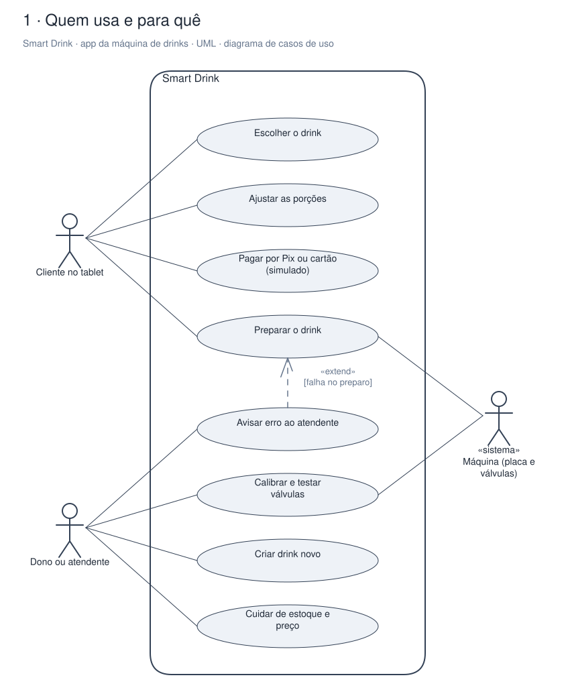
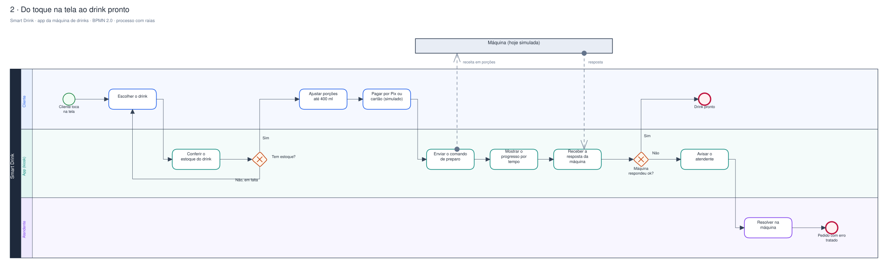
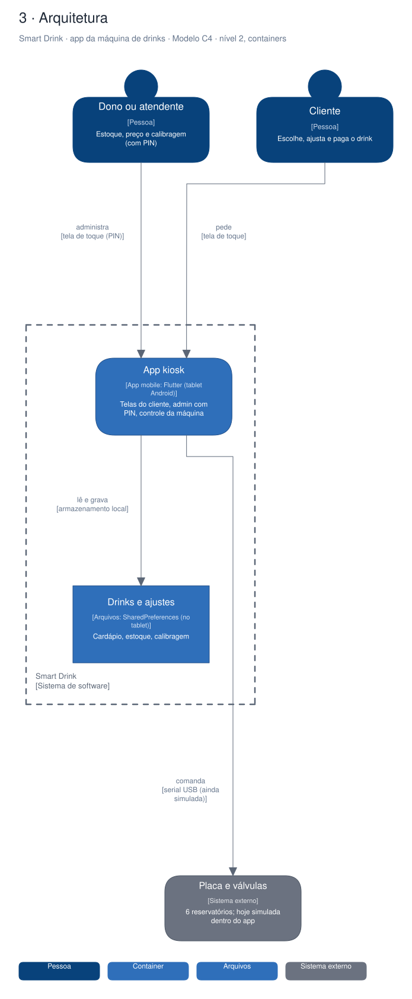

# Arquitetura

Diagramas gerados a partir do Sinapse (o segundo cérebro do Pedro). Cada projeto tem três vistas,
cada uma numa notação padrão:

1. **Quem usa e para quê**: UML, diagrama de casos de uso.
2. **O processo principal**: BPMN 2.0, com raias por quem executa.
3. **A arquitetura**: modelo C4, nível 2 (containers).

## Smart Drink · app da máquina de drinks

App Flutter em modo kiosk, no tablet da máquina Smart Drink: o cliente escolhe e ajusta o drink, paga por Pix ou cartão (ainda simulado) e a máquina dosa de 6 reservatórios. Hoje roda inteiro com a máquina simulada.

### Quem usa e para quê (UML)

### Do toque na tela ao drink pronto (BPMN 2.0)

### Arquitetura (C4, containers)

Editável: [`smartdrinkapp.excalidraw`](./smartdrinkapp.excalidraw), abre em [excalidraw.com](https://excalidraw.com) ou no VS Code com a extensão Excalidraw.

A fonte destes arquivos é o vault do Sinapse (`09-DESENHOS/`); alterações feitas aqui são sobrescritas na próxima publicação.
