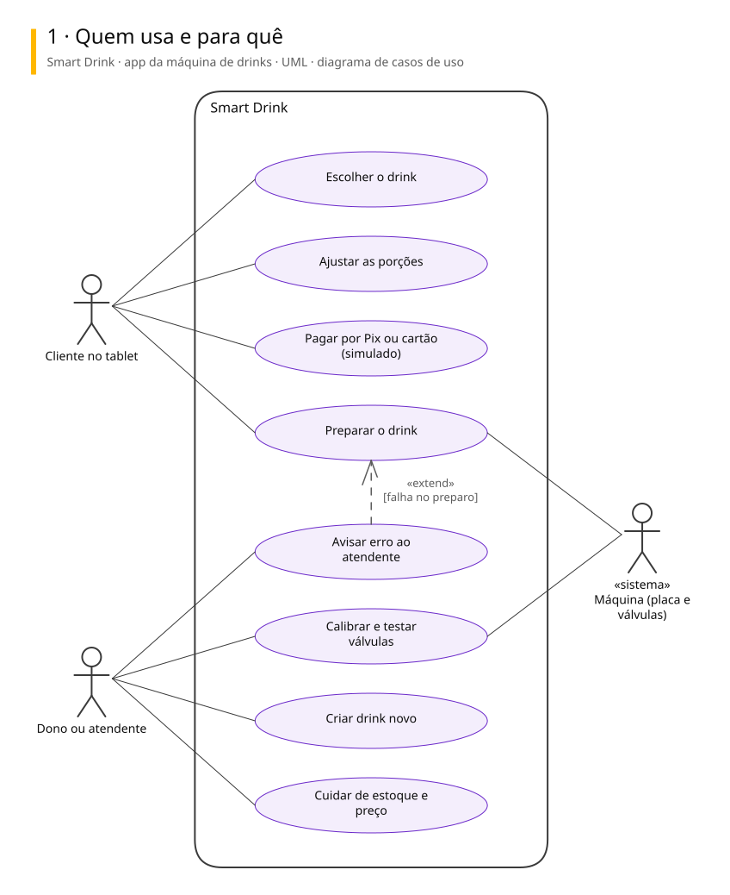
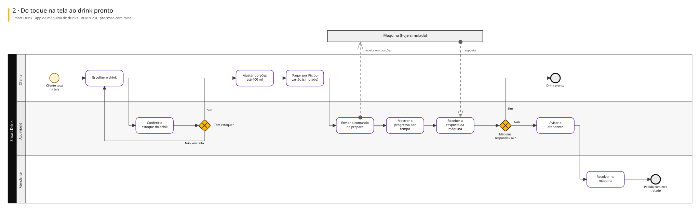
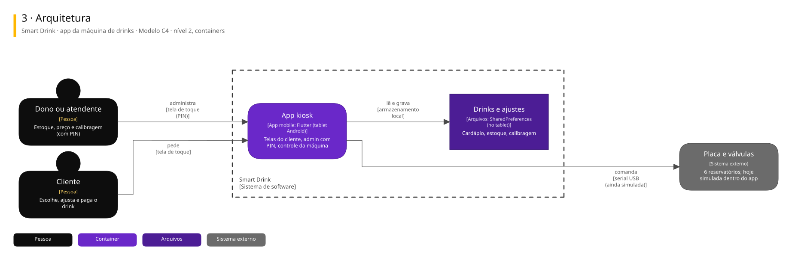

# Arquitetura

Três vistas do sistema, cada uma numa notação padrão.

| Vista | Notação | Responde |
|---|---|---|
| 1. Casos de uso | UML | Quem usa e para quê |
| 2. Processo | BPMN 2.0 | Como o trabalho anda, com uma raia para cada quem executa |
| 3. Arquitetura | C4, nível 2 | De que partes o sistema é feito e com quem conversa |

## Smart Drink · app da máquina de drinks

App Flutter em modo kiosk, no tablet da máquina Smart Drink: o cliente escolhe e ajusta o drink, paga por Pix ou cartão (ainda simulado) e a máquina dosa de 6 reservatórios. Hoje roda inteiro com a máquina simulada.

### 1. Quem usa e para quê

### 2. Do toque na tela ao drink pronto

### 3. Arquitetura

Para editar: [smart-drink.excalidraw](./smart-drink.excalidraw), que abre em [excalidraw.com](https://excalidraw.com) ou na extensão Excalidraw do VS Code.

## De onde vêm

Os diagramas são gerados a partir do Sinapse, o vault onde o Pedro organiza notas e projetos. Mudança feita direto aqui some na próxima publicação: o lugar de mudar é a especificação no Sinapse.
